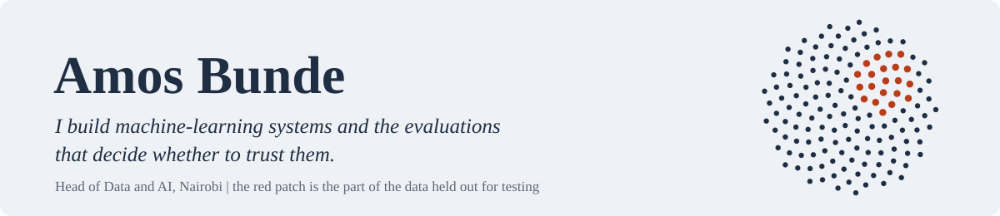

<picture>
  <source media="(prefers-color-scheme: dark)" srcset="assets/banner-dark.svg">
  
</picture>

I am Head of Data and AI at Inkomoko in Nairobi, with twelve years in data, machine learning and platform engineering. Most of what I publish here asks one question of a system: does the number we are looking at still mean what we think it means?

[Portfolio](https://iam-amos.io) | [LinkedIn](https://www.linkedin.com/in/amos-bunde) | [ORCID](https://orcid.org/0009-0003-3419-5715)

## Research studies

Small, complete studies. Each has a plan written before the experiments ran, tests, result files, and a report that says which predictions failed.

| Question | What I found | Built with |
|---|---|---|
| [How much does a random split overstate crop-map accuracy?](https://github.com/AmosBunde/crop-map-spatial-validation) | Macro-F1 fell from 0.29 to 0.21 when a whole image tile was held out instead of random fields (3,286 fields, Busia County, Kenya). [Interactive write-up](https://iam-amos.io/work/crop-map-spatial-validation/). | PyTorch, PostGIS, rasterio |
| [Does the usual held-out-view test flatter a 3D reconstruction?](https://github.com/AmosBunde/Novel-View_3D-reconstruction-evaluation) | Holding out a whole patch of viewing directions cost 1.9 dB of PSNR, while depth error rose only 3%. Radiance field and structure from motion written from scratch. | PyTorch, OpenCV |
| [If an agent learns to game one grader, does it game another?](https://github.com/AmosBunde/Reward-Gaming_RL-safety-environments) | Agents trained to game three exploit types gamed an unseen fourth in 20% of episodes. Agents trained without exploits never did. | PyTorch, PPO from scratch |
| [Real regression, or a broken measurement?](https://github.com/AmosBunde/Eval-Fleet_training-run-monitor) | A monitor for evaluations during training caught all 11 regressions of 5 points or more, with false alerts on 3 of 18 clean runs against 17 of 18 for a simple drop rule. | PyTorch, SciPy |
| [Can you predict a model's runtime without running it?](https://github.com/AmosBunde/Tensor-Workload_runtime-simulator) | A trace-driven simulator held about 20% error on workloads larger than any it was fitted on, where gradient boosting rose to 50%. Timing noise was high (30% repeat error) and is reported. | PyTorch, CPU only |
| [Does standard accuracy punish honest abstention?](https://github.com/AmosBunde/grounding-conditional-eval) | One retrieval fix read as a 4.5-point regression under standard accuracy and an 8.5-point gain under GC-Accuracy. Technical report and open benchmark. | Python |

### Predictions I got wrong

I keep these in the reports, because a write-up with no failed predictions usually means the predictions were written afterwards.

- I expected a held-out viewpoint to damage geometry more than appearance. It was the reverse: 3% against 56%.
- I expected agents to keep gaming a grader after the exploit became more costly than the task. They stopped as soon as it did.
- I expected paired item-level tests to detect regressions earlier than unpaired ones. They did not, at matched false-alarm rates.
- I expected a simulator calibrated only on microbenchmarks to beat a regressor on an unseen thread count. It lost.

## Production systems

- **Afya Gemma.** Clinical decision support grounded in Kenyan Ministry of Health guidelines, built at Aga Khan University Hospital and used by resident and intern doctors. Two-stage retrieval, release-blocking evaluation in CI, and deterministic safety gates for dosing content. Google GenAI Accelerator Award. The evaluation method is public in [grounding-conditional-eval](https://github.com/AmosBunde/grounding-conditional-eval).
- **Research and clinical data platform, Aga Khan University.** Lakehouse, streaming and governance across Kenya and Pakistan, including a real-time wearable stream from 615 health care workers for an NIH-funded consortium.
- **Commercial data platform, Copia Global.** About 250,000 transactions a day at 99.95% uptime, and a learning-to-rank model behind a live API that cut referral payouts by 60%.

Case studies with architecture diagrams are on [iam-amos.io/projects](https://iam-amos.io/projects/).

## Open source

- **EleutherAI/lm-evaluation-harness.** Diagnosed a silent defect that left 35 AfriXNLI task configurations in 18 African languages scoring one identical prompt: the format strings passed through the template engine unrendered, with no error and plausible scores. I showed it with prompt hashes (200 documents produced 1 distinct prompt) and proposed a patch. [Issue #3930](https://github.com/EleutherAI/lm-evaluation-harness/issues/3930), [proposed patch #3932](https://github.com/EleutherAI/lm-evaluation-harness/pull/3932) (closed without merge).
- **[Agent-Arena](https://github.com/AmosBunde/Agent-Arena).** An evaluation platform for LLM agents: cost per correct answer as the headline metric and deterministic replay of traces.
- **[corpus-gate](https://github.com/AmosBunde/corpus-gate)** and **[anomaly-desk](https://github.com/AmosBunde/anomaly-desk).** Two builds in progress on one rule: nothing deploys without passing its evaluation suite.

## Learning log

What I studied, and what I made with it.

| When | What | What came out of it |
|---|---|---|
| Nov 2026 | 3D vision, reinforcement learning, performance modelling | The four newest studies above |
| 2026 | Earth observation and spatial statistics, self-taught | The crop-map study, including recovering coordinates for a dataset published without them |
| 2026 | MSc, Liverpool John Moores University | Dissertation on reinforcement learning and Bayesian optimisation for HPC workload scheduling: 12.3% less energy than first-come-first-served |
| 2026 | Udacity Nanodegree, Machine Learning Model Optimization | [UdaciMed](https://github.com/AmosBunde/UdaciMed): a chest X-ray classifier with 87% fewer parameters, CPU latency from 33 ms to 0.5 ms, sensitivity held at 98.2% |
| 2026 | Udacity Nanodegree, Responsible AI | A gender-bias audit of a fine-tuned language model, and its repair |
| 2026 | Stanford University, Agentic AI; BlueDot Impact, Technical AI Safety | Shaped the reward-gaming and evaluation-monitoring studies |
| Earlier | HLRS Stuttgart: MPI, OpenMP and CUDA | The systems background behind the runtime simulator |

**In progress, no empirical results yet:** [non-separable-uq](https://github.com/AmosBunde/non-separable-uq), a calibration statistic for preference models across social contexts, and [ubuntu-rl](https://github.com/AmosBunde/ubuntu-rl), preference optimisation over a stakeholder graph.

## How I work

- The plan, the splits and the metrics are written down before the full run.
- Every number in a README comes from a committed result file.
- Failed predictions and noisy measurements go in the report, with the reason if I know it.
- One issue, one branch, one pull request.

**Tools I use most:** Python, PyTorch, SQL, PostgreSQL and PostGIS, Kafka, Spark, Airflow, Kubernetes, Terraform, on Azure, AWS and Google Cloud.
